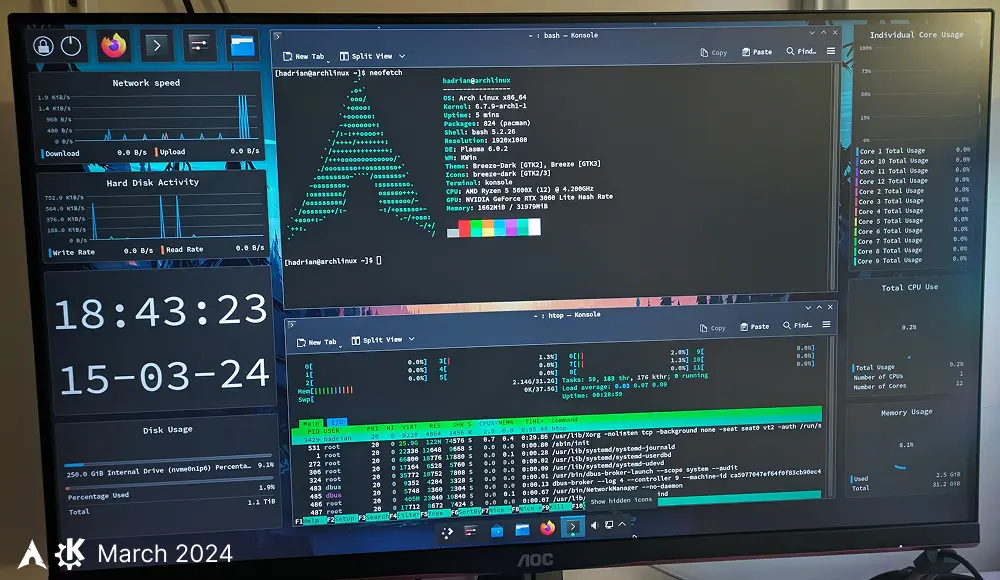
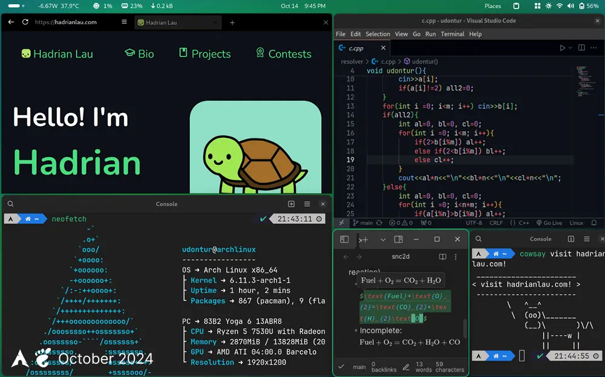
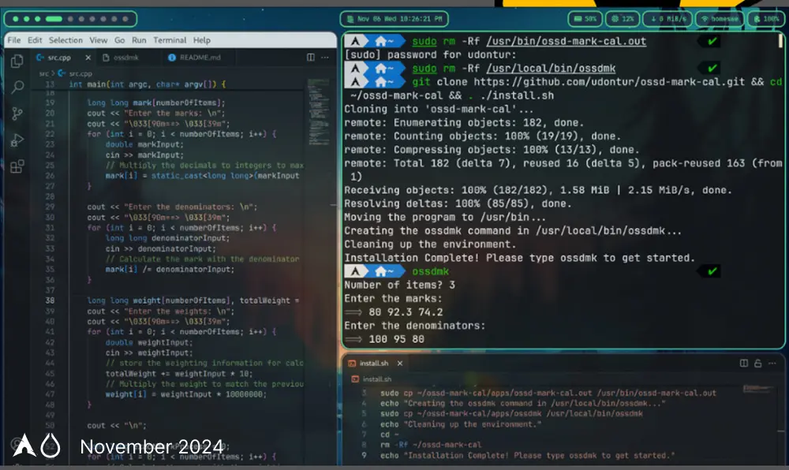
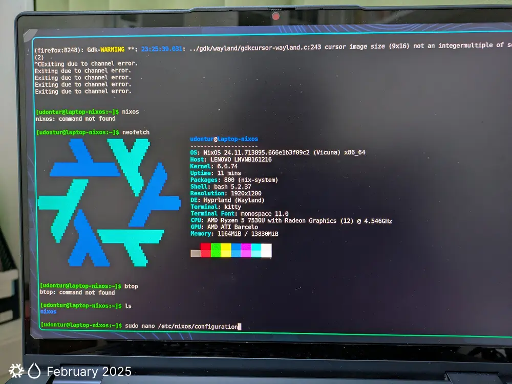
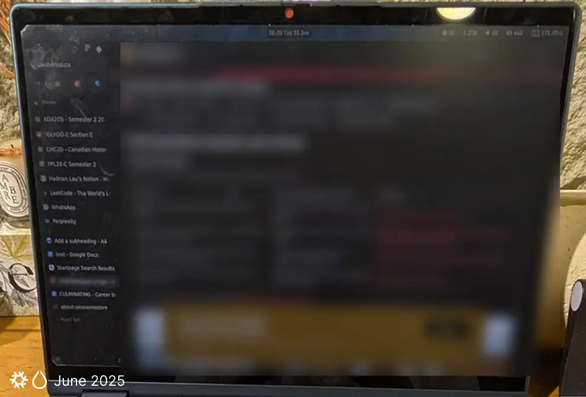
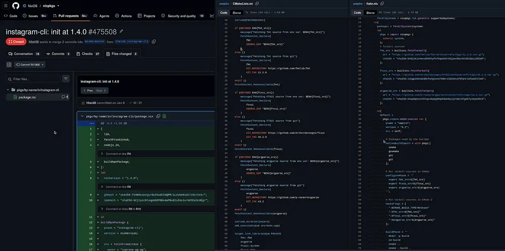
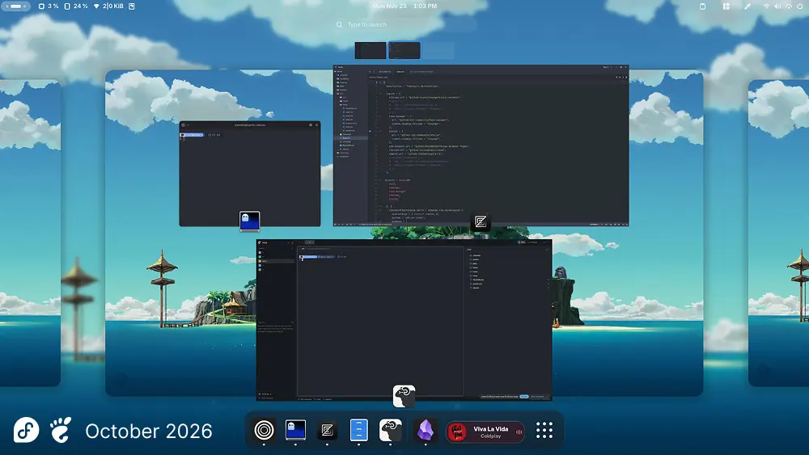

# ❄️ Turix
My NixOS configuration. ~95% reproducibility by ricing declaratively using Nix or synced via cloud accounts.  

> Currently remaking my entire NixOS config from scratch. 

# Story time! (Work In Progress)
Before I start yapping about my Linux journey, I just wanted to say, I already liked to "rice stuff" since my age has only one digit.

Take a look at this control panel for managing my technology island called SOM. 

And this monitor for my defense robots with a popcorn machine on the top left corner.

Well, it turns out this love for customization would push me into the rabbit hole of anything related to Linux and operating systems! 

## Arch Linux

I started off watching [this YouTube video](https://www.youtube.com/watch?v=xQblmLXIJyA) installing Arch and KDE because I saw someone yapping about Arch on Reddit (Yes, it is real). All those dashboards and widgets looks pretty cool to the 14 year old me. So spun up a VM and installed Arch with `archinstall` after a few failed attempts. I poked around for a while, and found I really liked the customization KDE offers. So I started ricing using the KDE settings, installed apps, and just generally poke around to get more comfortable with Linux. Things do feel a bit overwhelming to me. I had to learn how Linux work, how to install programs in the terminal, how to use the terminal, etc. They are completely different to windows. I was still daily driving windows at that time so, when I felt comfortable enough, I dual booted Arch with KDE for the first time in March 2024. 

I slowly migrated all of my Windows stuff here. I made some cool widgets, riced the browser, scrolled through the entire KDE setting, and installed some apps and tools. *But then*, I discovered a DE called Gnome and felt the design philosophy is much more intuitive, so I made a switch to Gnome!

So of course, I had to rice all of my stuff again because it is a fresh install. I added some gnome extensions, poked around, and installed more apps and tools. I used this setup for a few months on my PC and it is working well. All the apps and service I use work on Linux and I never booted up windows again unless I need it for gaming. I also replicated the setup on my laptop and started daily driving Linux in school. 

*But then*, while setting up "auto snapping grids" on my laptop, I discovered a thing called a tiling window managers. I found its design philosophy intuitive. Thats why I hopped to Hyprland, which automatically does the tiling for me! Hyprland is just a window manager, nothing came preinstalled. So I had to install things like waybar, rofi, gdm, etc to make the setup work more like a DE. This is when I became addicted to having a minimal setup because for some reason, it just feels great to know your computer does exactly what you want it to, and no more. Also, unlike Gnome, all settings are configured in a text file, which means I can backup my configs to git. 

## NixOS

As you Linux nerds might have guessed it, it broke, because I was updating Windows for my internship. I hate Windows. I will never dual boot anything again. 

Anyways, I have been eyeing NixOS for a while, so what’s a better excuse than a kernel panic to distro hop to NixOS? I have to be honest, NixOS is quite intimidating to me because it's very different from traditional Linux distros. All configs, including the entire system, is managed the Nix way. It took me quite some time to understand things partially and get a very basic setup working on my laptop. Nothing fancy just a very basic one file config with some settings, a few apps, and a WM. 

From that day on, I didn't distro hop or DE/WM hop anymore. I just riced my NixOS setup little by little every day. I riced most of my dotfiles decleratively using home manager, adding some programs like waybar, wofi, and zen, did a bunch of debugging and tinkering along the way. 

NixOS is working great for me because, again, the design philosophy sounds intuitive. Every system and app configuration is riced declaratively so I can see exactly what I installed and configured in my system. Because NixOS is immutable, if something broke, I can just roll back to the previous generation. Fearless ricing! (unless you're touching the bootloader). I will also have a nice backup of my entire system, which gives you a peace of mind that your computer is "safe".

As I get more comfortable with Nix and its ecosystem, I used Nix to managed my coding projects as well (right side). I also use Nix to create dev environments and even (almost) merged a package to nixpkgs (left side, but the original program broke mid-PR because Instagram banned accounts using third party apps)

## No more NixOS
I still have a shallow understanding NixOS, but before I dived deeper in to the documentation and tutorials, I lost patience with NixOS. I simply want things to work because a lot of the coding projects like electron, python, and cmake has to be done the Nix way with a lot of workarounds. It costed me a lot of time, and spending hours figuring out a workaround has became very unenjoyable because it happened so many times. Right now, I just want things to work out of the box.   

Being a non FHS distro with a not so main stream package manager means a lot of things doesn't work out of the box and require tons and tons of tinkering to get it working "properly". Python venv needs a patch, bluetooth is wonky even with a patch, and a bunch of apps and tools not even running because they cannot find a path to some libraries, updating one single flake breaks the config, and more random bugs when you just want things to work... I am so sorry, but I am tired of debugging these problems every day. 

The compatibility and stability of other distros outweighs the pros of Nix, so I decided to switch back to a more "beginner friendly" distro like Fedora + Gnome. I didn't do a lot of ricing, just a few gnome extensions and some new apps I discovered.  

Don't get me wrong, I still love ricing, Nix, and tinkering. But right I now I really want things to just work out of the box, and I think switching to a main stream distro is the right move.  

NixOS is a big part of my tech journey. Even though I am a stupid teenager, Nix taught me a lot about Linux, OS, software, and even some hardware through the countless hours of tinkering, configuring, and "researching" (poking around docs and forums lol). Oh btw if you are wondering, I still use Nix in some of my coding projects and servers, just not using it to manage my OS. 

Here is what my NixOS setup looks like before I made the switch. It uses the dank material shell.

Until then, NixOS.

> *P.S. I also use GrapheneOS for security and privacy*

> *P.S. I am also a PC hardware nerd*

## You know what, I am back on NixOS (Nov 2026)
Fedora + Gnome is lowkey pretty bloated in comparison to what I am used too. Tools like distrobox exists to bypass compatibility issues when coding, so there is no point of switching to Fedora just for compatibility and ease of use. And with NixOS, I get to declaratively rice my system, see my entire system in a bunch of text files, and reproducible when my computer is cooked. 

I am currently remaking my NixOS config from scratch to try to understand what each line of my config does to eliminate bloat and hopefully debug faster when I encounter bugs. 

I'm also swapping many apps and utils:
- Hyprland -> Niri
- VSCode -> Helix + Zed
- Kitty -> Ghostty
- Dank Material Shell -> None + Vicinae + Custom quickshell (hopefully)
- Using more TUI apps like broot, yazi, gitui

I'll keep writing once I have migrated everything to my new NixOS system.

> [!IMPORTANT]
> 😄 Happy 🐧 Linuxing!!!
