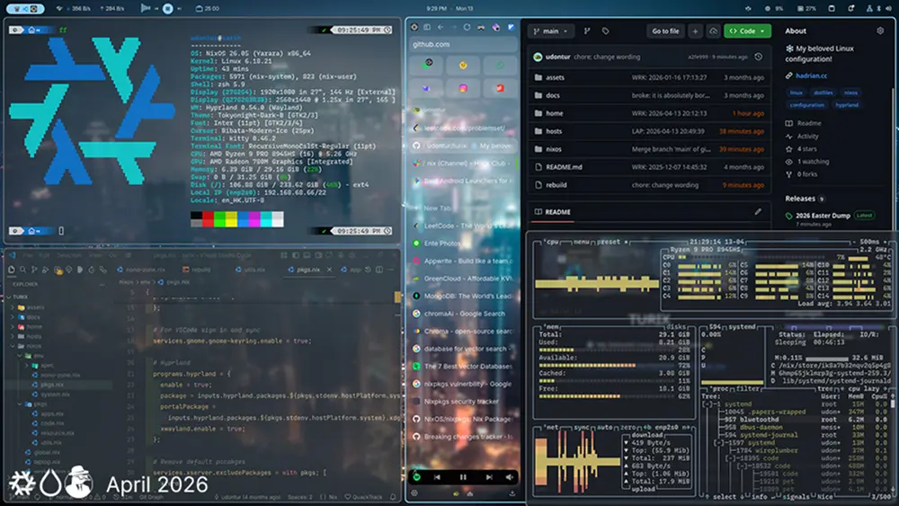
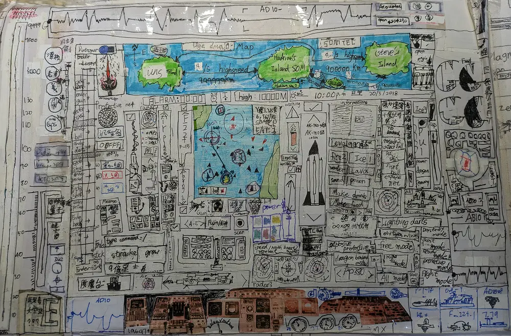
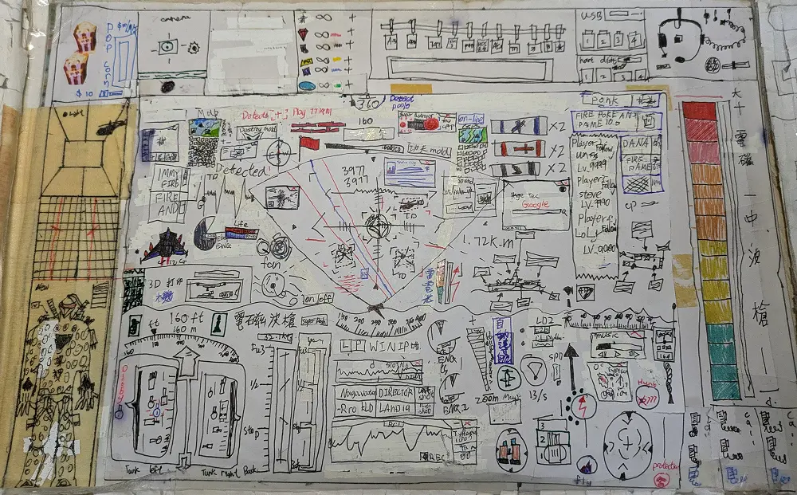
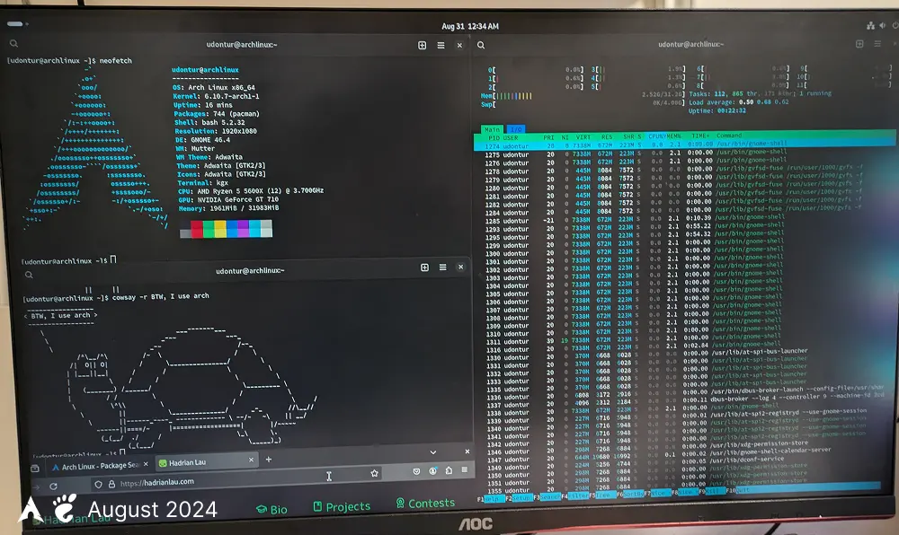
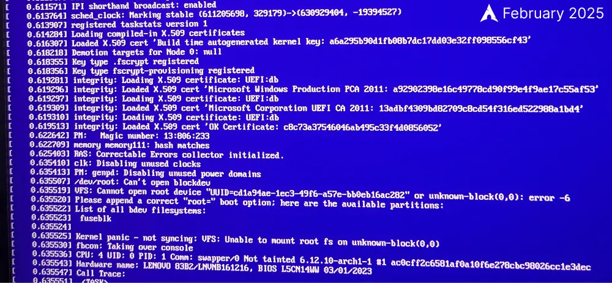
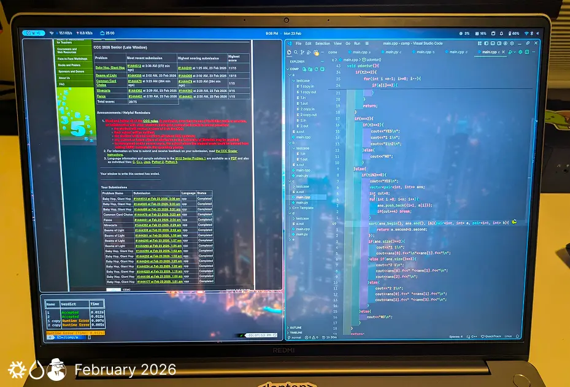

# ❄️ Turix
My NixOS configuration, ~95% reproducibility by ricing declaratively with Nix, with the rest synced via cloud accounts.

> Currently remaking my entire NixOS config from scratch.

# Story time!
*~1300 words, ~6 minute read*

Before I start yapping about my Linux journey, I just wanted to say that I already loved "ricing stuff" back when my age only had one digit.

Take a look at this control panel for managing my technology island called SOM:

And this monitor for my defense robots, with a popcorn machine in the top-left corner:

Well, it turns out this love for customization would push me into the rabbit hole of anything related to Linux and operating systems!

## Arch Linux

I started off watching [this YouTube video](https://www.youtube.com/watch?v=xQblmLXIJyA) about installing Arch and KDE because I saw someone yapping about Arch on Reddit (yes, that really happened). All those dashboards and widgets looked pretty cool to 14-year-old me, so I spun up a VM and installed Arch with `archinstall` after a few failed attempts. I poked around for a while and found that I really liked the customization KDE offers. So I started ricing using the KDE settings, installed apps, and generally poked around to get more comfortable with Linux.

Things did feel a bit overwhelming at first. I had to learn how Linux works, how to install programs in the terminal, how to use the terminal, etc., and it was completely different from Windows. I was still daily-driving Windows at the time, so once I felt comfortable enough, I dual-booted Arch with KDE for the first time in March 2024.

I slowly migrated all of my Windows stuff over. I made some cool widgets, riced the browser, scrolled through the entire KDE settings menu, and installed some apps and tools. *But then*, I discovered a DE called GNOME and felt its design philosophy was much more intuitive, so I made the switch!

So of course, I had to rice all of my stuff again because it was a fresh install. I added some GNOME extensions, poked around, and installed more apps and tools. I used this setup for a few months on my PC and it worked well. All the apps and services I used ran on Linux, and I never booted Windows again unless I needed it for gaming. I also replicated the setup on my laptop and started daily-driving Linux at school.

*But then*, while setting up "auto snapping grids" on my laptop, I discovered a thing called a tiling window manager. I found its design philosophy intuitive, that's why I hopped over to Hyprland, which automatically does the tiling for me! Hyprland is just a window manager, so nothing comes preinstalled. I had to install things like Waybar, Rofi, and GDM to make the setup work more like a DE. This is when I became addicted to having a minimal setup, because for some reason it just felt great to know my computer did exactly what I wanted it to, and no more. Also, unlike GNOME, all of Hyprland's settings live in text files, which meant I could back up my configs to git.

## NixOS

As you Linux nerds might have guessed, it broke, because I was updating Windows for my internship. I hate Windows. I will never dual-boot anything again.

Anyways, I had been eyeing NixOS for a while, so what's a better excuse than a kernel panic to distro-hop to NixOS? I have to be honest, NixOS was quite intimidating at first because it's very different from traditional Linux distros, everything, including the entire system, is managed the Nix way. It took me quite some time to partially understand things and get a very basic setup working on my laptop. Nothing fancy, just a very basic one-file config with some settings, a few apps, and a WM.

From that day on, I didn't distro-hop or DE/WM-hop anymore. I just riced my NixOS setup little by little every day. I riced most of my dotfiles declaratively using Home Manager, added some programs like Waybar, Wofi, and Zen, and did a bunch of debugging and tinkering along the way.

NixOS was working great for me because, again, the design philosophy sounded intuitive. Every system and app config is riced declaratively, so I can see exactly what I've installed and configured on my system. And because every generation is immutable, if something breaks, I can just roll back to the previous one, fearless ricing! (unless you're touching the bootloader). I also get a nice backup of my entire system configuration, which gives me peace of mind that my computer is "safe".

As I got more comfortable with Nix and its ecosystem, I started using Nix to manage my coding projects as well (right side). I also used it to create dev environments, and I even (almost) got a package merged into nixpkgs (left side, but the original program broke mid-PR because Instagram banned accounts using third-party apps).

## No more NixOS
I still only had a shallow understanding of NixOS, and before I could dive deeper into the documentation and tutorials, I lost patience with it. I simply wanted things to work, because a lot of my coding projects, the Electron, Python, and CMake, had to be done the Nix way with a lot of workarounds. It cost me a lot of time, and spending hours figuring out workarounds became very unenjoyable because it happened so many times. At that point, I just wanted things to work out of the box.

Here is what my NixOS setup looked like right before the switch, it runs DankMaterialShell (DMS):

Being a non-FHS distro with a not-so-mainstream package manager means a lot of things don't work out of the box and require tons and tons of tinkering to get them working "properly". Python venvs needed a patch, Bluetooth was wonky even with a patch, a bunch of apps and tools wouldn't even run because they couldn't find the libraries they needed, updating a single flake input broke the config, and there were more random bugs right when I just wanted things to work... I'm sorry, NixOS, but I was tired of debugging these problems every day.

The compatibility and stability of other distros outweigh the pros of NixOS, so I decided to switch to a more "beginner-friendly" distro: Fedora + GNOME. I didn't do a lot of ricing, just a few GNOME extensions and some new apps I discovered.

Don't get me wrong, I still love ricing, Nix, and tinkering. But at the time I really wanted things to just work out of the box, and I figured switching to a mainstream distro was the right move.

NixOS is still a big part of my tech journey. Even though I'm a stupid teenager, Nix taught me a lot about Linux, operating systems, software, and even some hardware through countless hours of tinkering, configuring, and "researching" (poking around docs and forums lol). Oh btw, if you're wondering: I still use Nix in some of my coding projects and on my servers, I just don't use it to manage my OS.

Until then, NixOS.

> *P.S. I also use GrapheneOS for security and privacy*
> *P.S. I am also a PC hardware nerd*

## You know what, I am back on NixOS (Nov 2026)
Fedora + GNOME is lowkey pretty bloated compared to what I'm used to. The bugs on NixOS are still annoying, but they're livable, and tools like Distrobox handle coding-side compatibility anyway, so there was no point in switching to Fedora just for compatibility and ease of use. Plus, with NixOS I get to declaratively rice my system, see my entire system in a bunch of text files, and have it all reproducible when my computer is cooked.

I am currently remaking my NixOS config from scratch so I can actually understand what each line of my config does, eliminate bloat, and hopefully debug faster when I encounter bugs.

I'm also swapping out a lot of my apps and utils:

- Hyprland -> Niri
- VSCode -> Helix + Zed
- Kitty -> Ghostty
- DankMaterialShell -> none (Vicinae for launching + a custom Quickshell setup, hopefully)
- More TUI apps -> broot, yazi, gitui

I'll keep writing once I've migrated everything to my new NixOS system.

> [!IMPORTANT]
> 😄 Happy 🐧 Linuxing!!!
