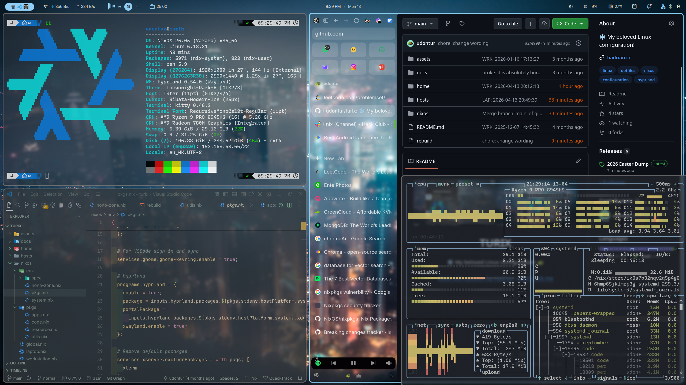
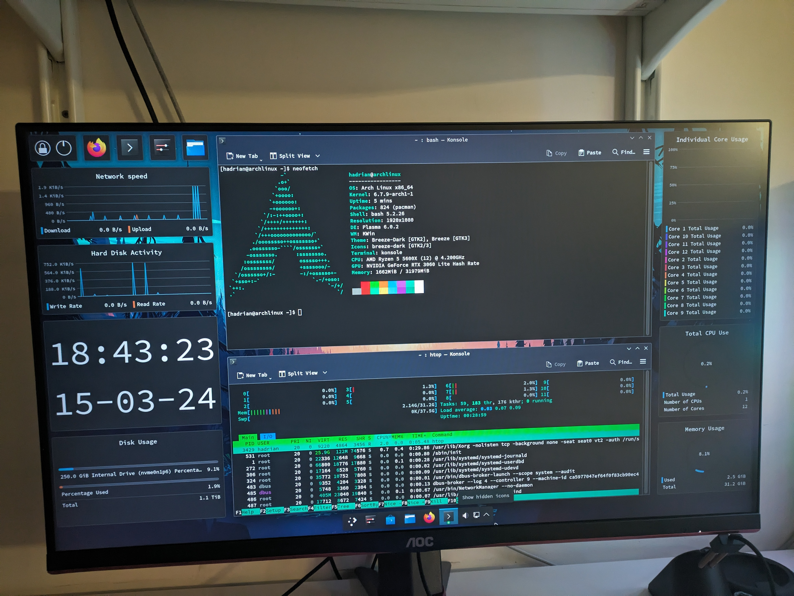

# ❄️ Turix
My NixOS dotfiles. Everything in this setup is riced declaratively (or sometimes synced via accounts) except for the browser. 

# Story time!
I started off watching people on YouTube installing Arch and KDE. All those dashboards looks pretty cool to the 14 year old me. So spun up a VM and installed Arch with `archinstall` after a few failed attempts. I poked around for while, and found I really liked the customization KDE offers. So I started ricing using the KDE settings, installed apps, and just generally poke around to get more comfortable with Linux. Things do feel a bit overwhelming to me. I had to learn how Linux work, how to install programs in the terminal, how to use the terminal, etc. They are comletely different to windows. I was still daily driving windows at that time so, when I felt comfortable enough, I dual booted Arch with KDE for the first time in March 2024. 

I slowly migrated my Windows stuff, daily driving Arch Linux with gnome in November 2024. 

Then while i was ricing gnome, i found out that I really like tiling WMs and and fully customizability so i switched to Arch with hyprland. Everything was working smoothly until dual booting bricked my Arch setup. I decided to completely wipe windows out and starts using NixOS because I don't wanna loose all of my stuff again. 

I Daily drove NixOS for 1.4 years: Feburary 2025 - July 2026

I switched to NixOS because it
- Provides a delcarative way to rice my stuff 
- I can see what is installed and what is changed
- Everything is reproducible (peace of mind)
- Gives me reproducable development environments

Unfortunately I no longer daily drive NixOS because I lost patience. I simply want things to work. 

It was a wild and exciting journey. NixOS taught me a lot about Linux, ricing, and of course Nix. Ricing and tinkering with Linux became one of my biggest hobbies. 

I left NixOS because:
- Being non FHS means a lot of things does not work
- A lot of things need quite some tinkering to get it working, which i no longer have the patience to do
- Compatability and stability of other distros outweighs the pros of Nix

Until then, NixOS.

P.S. I still use Nix in my coding projects
