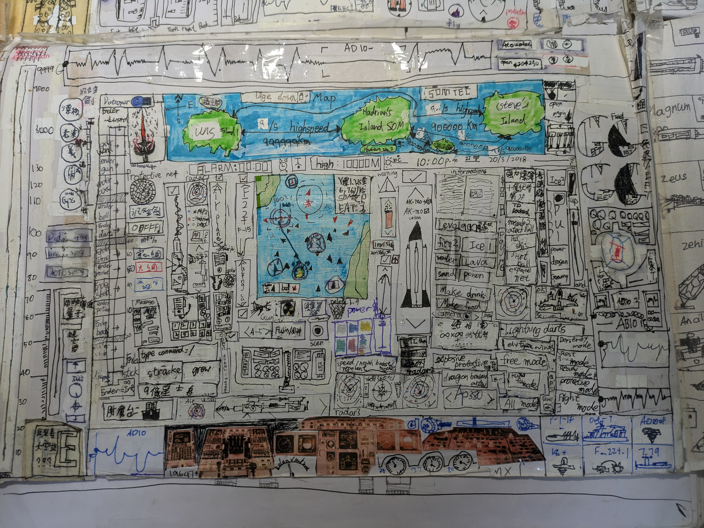
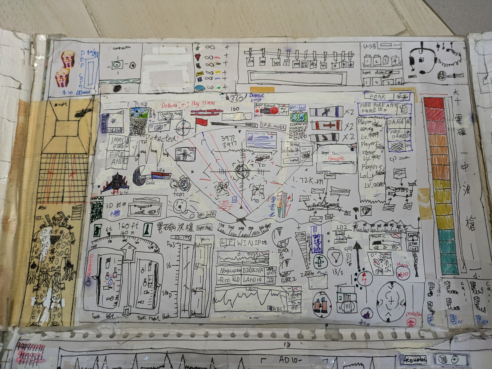
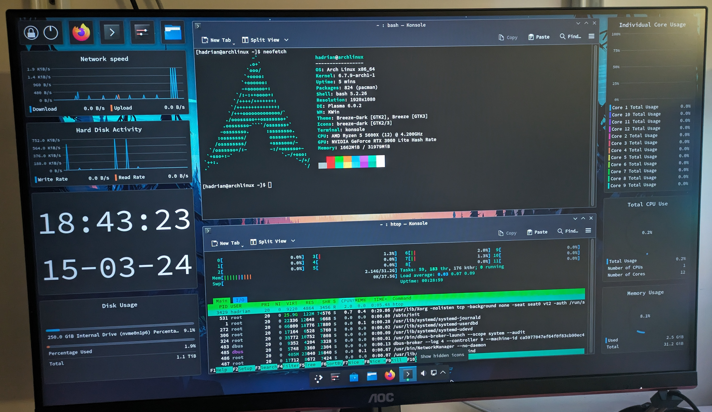
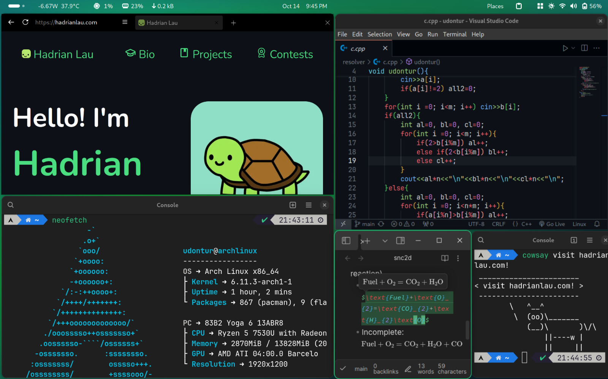
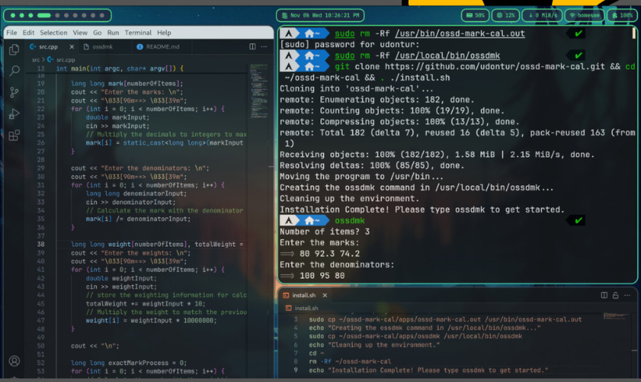

# ❄️ Turix
My NixOS dotfiles. 95% reproducibility by ricing declaratively using Nix or synced via cloud accounts.  

Currently remaking my entire NixOS config from scratch. 

# Story time!
Before I start yapping about my Linux journey, I just wanted to say, I already like to "rice stuff" since my age has only one digit.

Take a look at this control panel for managing my island and technology lab called SOM. 

And this monitor for my defense robots with a popcorn machine on the top left corner.

Well, it turns out this love for customization would push me into the rabbit hole of Linux! 

I started off watching [this YouTube video](https://www.youtube.com/watch?v=xQblmLXIJyA) installing Arch and KDE. All those dashboards and widgets looks pretty cool to the 14 year old me. So spun up a VM and installed Arch with `archinstall` after a few failed attempts. I poked around for while, and found I really liked the customization KDE offers. So I started ricing using the KDE settings, installed apps, and just generally poke around to get more comfortable with Linux. Things do feel a bit overwhelming to me. I had to learn how Linux work, how to install programs in the terminal, how to use the terminal, etc. They are comletely different to windows. I was still daily driving windows at that time so, when I felt comfortable enough, I dual booted Arch with KDE for the first time in March 2024. 

I slowly migrated all of my Windows stuff here. I made some cool widgets, riced the browser, scrolled through the entire KDE setting, and installed some apps and tools. *But then*, I discovered a DE called Gnome and felt the design philosophy is much more intuitive, so I made a switch to Gnome!

So of course, I had to rice all of my stuff again because it is a fresh install. I added some gnome extensions, poked around, and installed more apps and tools. *But then*, while setting up a tiling shell, I discovered a WM called Hyprland that automatically does the tiling for me! This is exactly what I wanted so I hopped over to Hyprland. 

Then while i was ricing gnome, i found out that I really like tiling WMs and and fully customizability so i switched to Arch with hyprland. Everything was working smoothly until dual booting bricked my Arch setup. I decided to completely wipe windows out and starts using NixOS because I don't wanna loose all of my stuff again. 

I Daily drove NixOS for 1.4 years: Feburary 2025 - July 2026

I switched to NixOS because it
- Provides a delcarative way to rice my stuff 
- I can see what is installed and what is changed
- Everything is reproducible (peace of mind)
- Gives me reproducable development environments

Even get to merge a PR to nixpkgs but I can't merge it because instagram blocked bot sign ins. 

Unfortunately I no longer daily drive NixOS because I lost patience. I simply want things to work. Being a non FHS and immutable distro means a lot of things does not work out of the box and require tons and tons of tinkering to get it working "properly". Python venv needs a patch, bluetooth is wonky even with a patch, and a bunch of apps and tools not running because they cannot find a path, updating a channel breaks the config and some random stuff, ... I am so sorry, but I am tired of debugging these problems every day. The compatability and stability of other distros outweighs the pros of Nix for me, so I decided to switch away. 

[fedora setup]

Don't get me wrong, I still love ricing, Nix, and tinkering. But right I now I really want things to just work out of the box, and switching away from NixOS to more "beginner friendly" distros is the best way to do it.  

NixOS is a big part of my tech journey. Even though I am a stupid teenager, Nix still taught me a lot about Linux and technology in general through the countless hours of tinkering, configuring, and "researching" (poking around docs and forums). 

Until then, NixOS.

*P.S. I still use Nix in my coding projects and servers, just not using it to manage my OS*

# Update
I low key wanna switch back to NixOS because Fedora + Gnome is pretty "bloated" in comparison to what I am used too. I install most apps using flatpak anyway, and I can use podman and distro to avoid all the compatibilities hassles. I really want to use a clean declarative Niri setup with Helix, Zellji, Yazi,
# ❄️ Turix
My NixOS dotfiles. Everything in this setup is riced declaratively (or sometimes synced via accounts) except for the browser. 

# Story time!
Before I start yapping about my Linux journey, I just wanted to say, I already like to "rice stuff" since my age has only one digit.

Take a look at this control panel for managing my island and technology lab called SOM. 

And this monitor for my defense robots with a popcorn machine on the top left corner.

Well, it turns out this love for customization would push me into the rabbit hole of Linux! 

I started off watching [this YouTube video](https://www.youtube.com/watch?v=xQblmLXIJyA) installing Arch and KDE. All those dashboards and widgets looks pretty cool to the 14 year old me. So spun up a VM and installed Arch with `archinstall` after a few failed attempts. I poked around for while, and found I really liked the customization KDE offers. So I started ricing using the KDE settings, installed apps, and just generally poke around to get more comfortable with Linux. Things do feel a bit overwhelming to me. I had to learn how Linux work, how to install programs in the terminal, how to use the terminal, etc. They are comletely different to windows. I was still daily driving windows at that time so, when I felt comfortable enough, I dual booted Arch with KDE for the first time in March 2024. 

I slowly migrated all of my Windows stuff here. I made some cool widgets, riced the browser, scrolled through the entire KDE setting, and installed some apps and tools. *But then*, I discovered a DE called Gnome and felt the design philosophy is much more intuitive, so I made a switch to Gnome!

So of course, I had to rice all of my stuff again because it is a fresh install. I added some gnome extensions, poked around, and installed more apps and tools. *But then*, while setting up a tiling shell, I discovered a WM called Hyprland that automatically does the tiling for me! This is exactly what I wanted so I hopped over to Hyprland. 

Then while i was ricing gnome, i found out that I really like tiling WMs and and fully customizability so i switched to Arch with hyprland. Everything was working smoothly until dual booting bricked my Arch setup. I decided to completely wipe windows out and starts using NixOS because I don't wanna loose all of my stuff again. 

I Daily drove NixOS for 1.4 years: Feburary 2025 - July 2026

I switched to NixOS because it
- Provides a delcarative way to rice my stuff 
- I can see what is installed and what is changed
- Everything is reproducible (peace of mind)
- Gives me reproducable development environments

Even get to merge a PR to nixpkgs but I can't merge it because instagram blocked bot sign ins. 

Unfortunately I no longer daily drive NixOS because I lost patience. I simply want things to work. Being a non FHS and immutable distro means a lot of things does not work out of the box and require tons and tons of tinkering to get it working "properly". Python venv needs a patch, bluetooth is wonky even with a patch, and a bunch of apps and tools not running because they cannot find a path, updating a channel breaks the config and some random stuff, ... I am so sorry, but I am tired of debugging these problems every day. The compatability and stability of other distros outweighs the pros of Nix for me, so I decided to switch away. 

[fedora setup]

Don't get me wrong, I still love ricing, Nix, and tinkering. But right I now I really want things to just work out of the box, and switching away from NixOS to more "beginner friendly" distros is the best way to do it.  

NixOS is a big part of my tech journey. Even though I am a stupid teenager, Nix still taught me a lot about Linux and technology in general through the countless hours of tinkering, configuring, and "researching" (poking around docs and forums). 

Until then, NixOS.

*P.S. I still use Nix in my coding projects and servers, just not using it to manage my OS*

# Update
I low key wanna switch back to NixOS because Fedora + Gnome is pretty "bloated" in comparison to what I am used too. I install most apps using flatpak anyway, and I can use podman and distro to avoid all the compatibilities hassles. I really want to use a clean declarative Niri setup with Helix, Zellji, Yazi,
